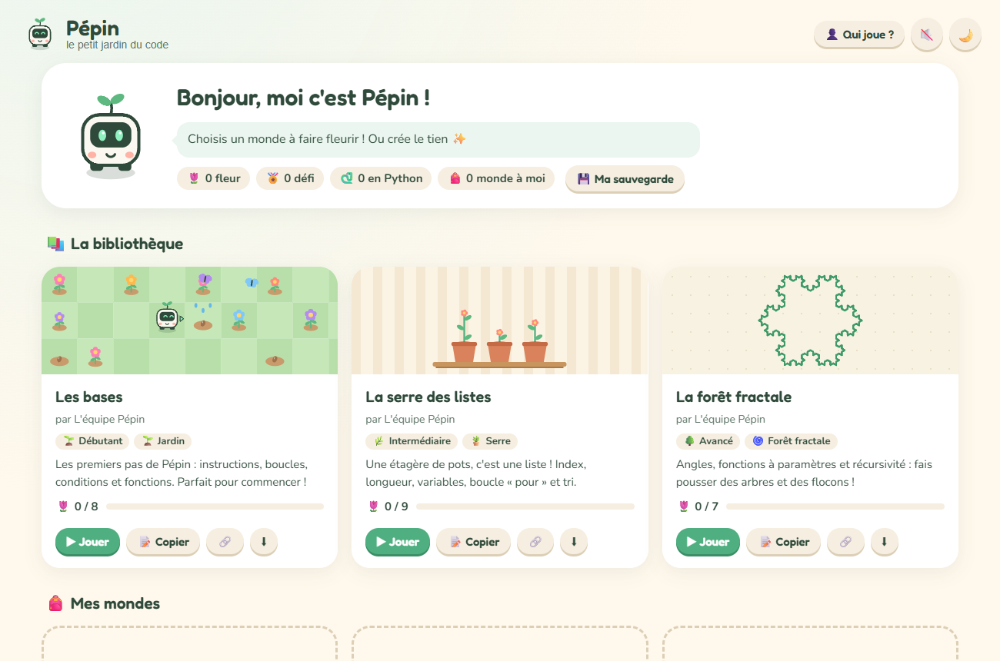
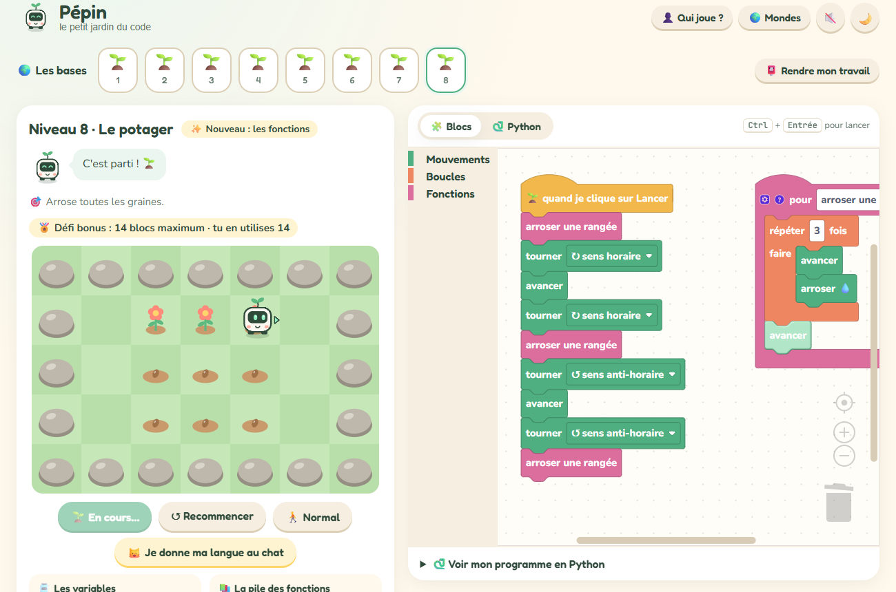
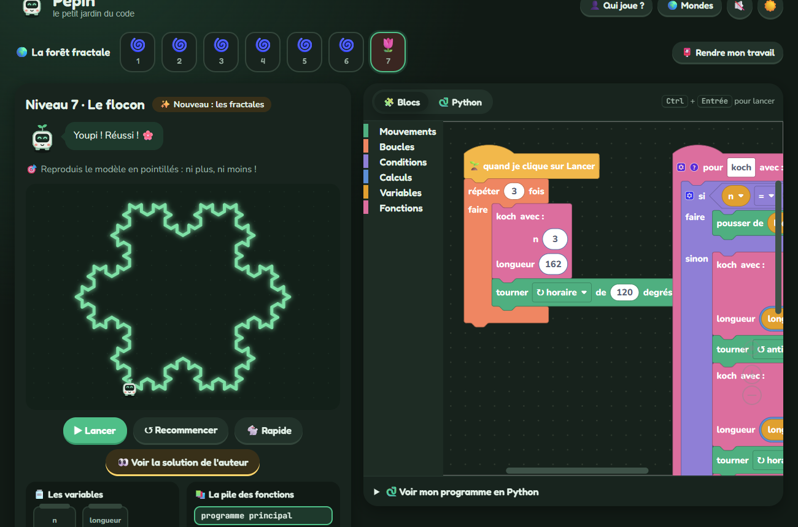
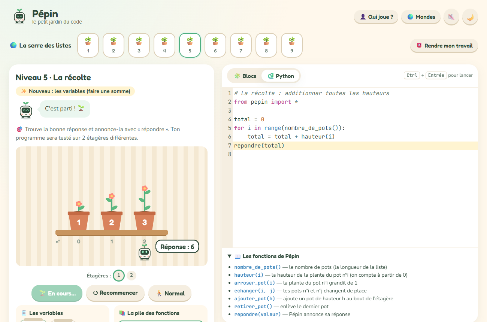
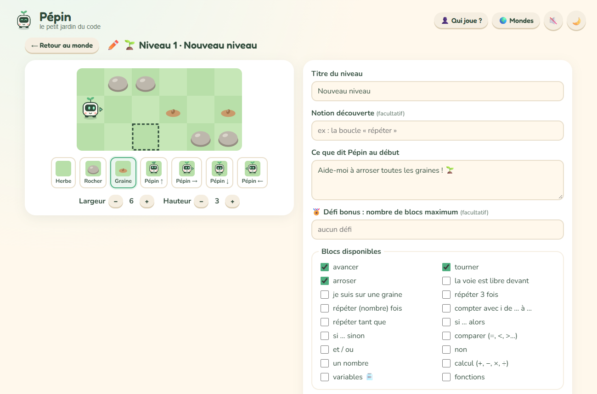
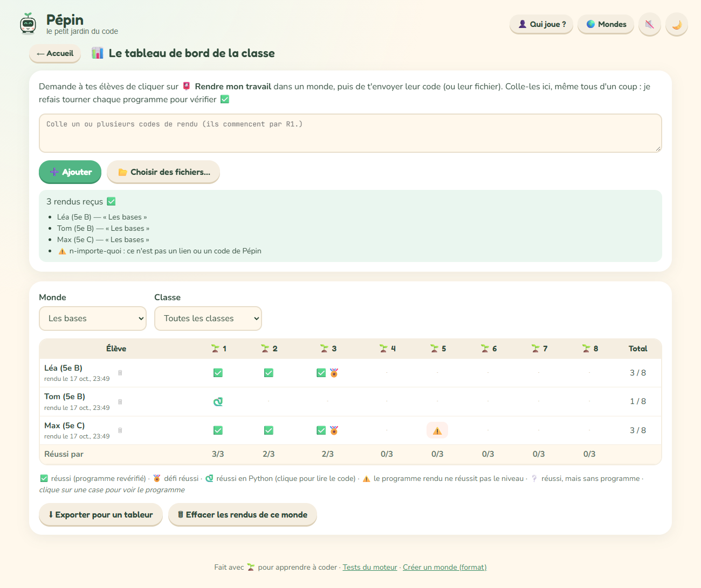

# 🌱 Pépin — le petit jardin du code

**Pépin** est un petit robot jardinier qu'on programme pour faire fleurir des jardins, ranger une serre et faire pousser des forêts fractales. On le programme avec des **blocs** (comme Scratch), ou en **vrai Python** pour les plus courageux.

C'est un jeu web éducatif pour apprendre la programmation, de l'école primaire jusqu'au lycée. Il marche sans inscription et sans serveur : tout tourne dans le navigateur.

**🎮 Jouer en ligne : <https://timothemontoya.github.io/pepin/>** (sur iPhone : Partager → « Sur l'écran d'accueil » pour l'installer comme une app)



## ✨ Ce que fait le jeu

- **58 niveaux dans 8 mondes**, du tout premier « avancer » (dès le CP) jusqu'à la dichotomie, la courbe du dragon et le triangle de Sierpiński (🔥 expert).
- **🔎 Une recherche** par mot (« récursivité », « tri », « labyrinthe »…), par difficulté, par type de niveau et par progression. Elle trouve aussi les niveaux eux-mêmes, pour aller droit au but.
- **🧩 Des blocs ou 🐍 du vrai Python.** Python tourne dans le navigateur grâce à Pyodide. Les erreurs sont traduites en français, adaptées aux élèves (« Ligne 3 : je ne connais pas « avancr » »).
- **🫙 La mémoire visible.** Pendant l'exécution, chaque variable est affichée dans un bocal, et la pile des fonctions grandit à chaque appel récursif. C'est l'idéal pour *voir* ce que fait un programme.
- **🏖️ Un bac à sable** : un jardin, une serre et une forêt où l'on programme ce qu'on veut, sans niveau à réussir, avec tous les blocs. Le bouton 🎲 tire un nouveau terrain au hasard.
- **👣 Le mode pas à pas.** Chaque clic exécute une seule action : le bloc (ou la ligne Python) en cours s'allume, et Pépin raconte ce qu'il fait (« Je tourne de 144° ↻ »).
- **🧪 Des niveaux qu'on ne réussit pas « par cœur ».** Un même programme est testé sur plusieurs jardins, plusieurs étagères… et certains niveaux limitent le nombre de pots qu'on a le droit de regarder : seul un algorithme rapide passe (la complexité !).
- **🐛 Des programmes à déboguer**, déjà écrits mais pleins de bugs, à suivre au pas à pas.
- **📏 Des repères pour les fractales.** Pépin donne les tailles du modèle (premier trait, plus petit trait, angle des virages), et les blocs arrivent réglés sur ces valeurs.
- **Des niveaux qu'on ne peut pas réussir en trichant.** Dans la serre, le programme est testé sur plusieurs étagères différentes, comme de vrais tests unitaires.
- **🏅 Des défis bonus**, par exemple finir en N blocs maximum.
- **🐱 « Je donne ma langue au chat »** : après 3 essais ratés, on peut voir la solution de l'auteur.
- **🛠️ Un éditeur de niveaux complet.** On peint le jardin, on prépare des étagères de test, on dessine le modèle d'une fractale… L'auteur doit réussir son propre niveau avant de pouvoir le partager.
- **🔗 Le partage par lien ou QR code.** Le monde entier est compressé dans le lien, sans aucun serveur. On peut aussi l'exporter dans un fichier `.pepin`.
- **📊 Un tableau de bord pour les profs.** Les élèves rendent leur travail avec un code, et le prof voit qui a réussi quoi. Chaque programme est revérifié automatiquement.
- **💾 Une sauvegarde de la progression**, pour la retrouver sur n'importe quel ordinateur.
- **📱 Une vraie petite app** : sur iPhone, « Partager → Sur l'écran d'accueil » ajoute Pépin avec son icône, en plein écran.
- **🔍 Zoom dans l'atelier** avec Ctrl + molette (ou en pinçant le pavé tactile).
- **🌙 Un mode nuit** (avec des lucioles), des sons doux à activer, le jeu complet au clavier et une mise en page adaptée aux téléphones et aux tablettes.

| Le jardin et ses fonctions | La forêt fractale, de nuit |
| --- | --- |
|  |  |
| **La serre, en Python** | **L'éditeur de niveaux** |
|  |  |

## 🗺️ Les mondes

| Monde | Niveaux | Ce qu'on y apprend |
| --- | --- | --- |
| 🌱 **Les petites graines** (débutant) | 8 | donner des ordres, l'ordre des instructions, s'orienter, tourner, faire demi-tour, répéter un motif |
| 🌱 **Les bases** (débutant) | 8 | instructions, boucles « répéter » et « tant que », conditions « si / sinon », fonctions |
| 🧭 **Le labyrinthe des capteurs** (intermédiaire) | 5 | boucles imbriquées, débogage, capteurs gauche / droite, fonctions + capteurs, l'algorithme de la main droite |
| 🪴 **La serre des listes** (intermédiaire) | 9 | listes et index (qui commencent à 0 !), longueur, ajout, boucle « pour », variables, somme, maximum, échange, inversion, tri à bulles |
| 📐 **L'atelier des formes** (intermédiaire) | 7 | motifs, angle extérieur, 360 ÷ n, fonctions à deux paramètres, rosaces (boucles imbriquées), compteur de boucle, découper en fonctions |
| 🧮 **Les algorithmes de la serre** (avancé) | 8 | compter, « et », modulo et parité, moyenne, position du minimum, recherche avec arrêt (le « et » paresseux), tri par sélection, dichotomie |
| 🌀 **La forêt fractale** (avancé) | 7 | angles, fonctions à paramètres, récursivité, arbre fractal, flocon de Koch |
| 🔥 **Le défi des experts** (expert) | 6 | parcours en serpentin, exploration complète d'un labyrinthe, dichotomie sur une « montagne », le mode (statistiques), Sierpiński, la courbe du dragon |

## 🧑‍🏫 Pour les profs

- **✨ Créer un monde** depuis l'accueil, ou **📝 copier** un monde de la bibliothèque pour l'adapter.
- Partager un monde à la classe avec un **lien** ou un **QR code** à projeter. Les élèves n'ont besoin d'aucun compte.
- Choisir si les élèves ont le droit de voir les solutions. Décochée, l'option **🔒 cache vraiment les solutions** : elles ne partent ni dans le lien, ni dans le fichier, donc impossible de les retrouver, même en fouillant. Pour la forêt, seul le dessin à reproduire est envoyé. Idéal pour une évaluation !
- Le format des fichiers est expliqué dans [mondes/README.md](mondes/README.md). Vous pouvez aussi proposer votre monde pour la bibliothèque !

### 📊 Suivre sa classe (sans serveur, sans compte)

1. L'élève indique son prénom et sa classe (👤 **Qui joue ?**).
2. Dans un monde, il clique sur **📮 Rendre mon travail** : le jeu fabrique un code (ou un fichier) qui contient ses niveaux réussis **et ses programmes gagnants**. Il l'envoie au prof (ENT, mail…).
3. Le prof colle tous les codes dans **📊 Suivre ma classe** et obtient un tableau élèves × niveaux, avec un filtre par classe et un export pour tableur.

Chaque programme rendu est **exécuté de nouveau** pour vérifier qu'il réussit vraiment le niveau : un rendu modifié à la main est signalé par ⚠️. On peut cliquer sur une case pour lire le programme de l'élève. Les programmes Python sont affichés sans être exécutés, par prudence.

Les données restent sur les ordinateurs : rien n'est envoyé sur internet. C'est un bon point pour le RGPD avec des élèves mineurs.



### 💾 Ne pas perdre sa progression

La progression est enregistrée automatiquement dans le navigateur. Avec **💾 Ma sauvegarde**, l'élève peut la télécharger (ou copier un code) pour la retrouver sur un autre ordinateur, ou après un nettoyage du navigateur. La restauration **ajoute** les niveaux sauvegardés, sans jamais rien effacer.

## 🚀 Lancer le jeu

Le jeu utilise des modules JavaScript, donc il faut l'ouvrir avec un petit serveur local :

```bash
python -m http.server 8080
```

Puis ouvrir <http://localhost:8080>. Avec VS Code, l'extension **Live Server** marche aussi.

### Le mettre en ligne avec GitHub Pages

1. Créer un dépôt sur GitHub et y envoyer tous les fichiers du projet.
2. Dans le dépôt : **Settings → Pages → Source : Deploy from a branch**, choisir la branche `main` et le dossier `/ (root)`.
3. Quelques minutes plus tard, le jeu est en ligne sur `https://<pseudo>.github.io/<nom-du-depot>/` 🎉

Aucune étape de compilation n'est nécessaire : le site est 100 % statique.

## 🔧 Comment c'est fait

- **HTML, CSS et JavaScript « à la main »**, en modules, sans framework ni outil de build.
- [Blockly 11](https://developers.google.com/blockly) pour les blocs et leur traduction en JavaScript et en Python.
- [Pyodide](https://pyodide.org) pour exécuter Python dans le navigateur, et [CodeMirror 5](https://codemirror.net/5/) pour l'éditeur de code.
- Tous les décors sont dessinés à la main dans des `<canvas>` : le jardin, la serre, la forêt… et Pépin lui-même.
- Les sons sont fabriqués avec la Web Audio API, sans aucun fichier audio.
- Le partage par lien compresse le monde (`CompressionStream`) puis l'encode en base64url dans l'adresse de la page.

```
index.html             la page du jeu
tests.html             les tests automatiques (116 tests)
css/style.css          le style, jour et nuit
mondes/                la bibliothèque de mondes (fichiers .pepin)
docs/captures/         les captures d'écran de ce README
js/main.js             le chef d'orchestre : accueil, jeu, partage, réglages
js/editeur.js          l'éditeur de mondes et de niveaux (l'interface)
js/edition.js          les outils de l'éditeur (pinceau, taille, id, blocs)
js/types.js            les 3 types de niveaux : jardin, serre, forêt
js/jardin.js           les règles du jardin
js/etagere.js          la serre : une liste de pots
js/fractale.js         la forêt : la liane de Pépin (une « tortue »)
js/execution.js        fait tourner le programme et enregistre chaque étape
js/blocs.js            les blocs, leurs traductions et les thèmes
js/boite-a-outils.js   les blocs proposés dans chaque niveau
js/solutions.js        vérifie les solutions et calcule les modèles
js/python.js           le mode Python (Pyodide + CodeMirror)
js/partage.js          les liens de partage, les codes et les QR codes
js/classe.js           le suivi de la classe : profil, sauvegarde, rendus
js/carnet.js           le carnet de l'élève (qui joue, sauvegarde, rendre)
js/tableau.js          le tableau de bord du prof
js/rendu.js            Pépin, le jardin, et la base des animations
js/rendu-serre.js      le décor de la serre
js/rendu-foret.js      le décor de la forêt
js/apercus.js          les miniatures des niveaux
js/bac-a-sable.js      le bac à sable (terrains libres, tirés au hasard)
icones/                l'icône de l'app (iPhone, Android, onglet)
manifest.webmanifest   pour installer Pépin comme une app
js/mondes.js           charger, vérifier, importer et exporter les mondes
js/theme.js            le mode nuit
js/sons.js             les petits sons
js/stockage.js         la sauvegarde dans le navigateur
```

## 🧪 Les tests

Ouvrir `tests.html`, avec le même serveur local. Ils vérifient le moteur du jeu, la serre, la forêt, le partage par lien… et que **chaque solution de la bibliothèque réussit bien son niveau**.

## 📖 Le parcours de développement

Ce jeu a été construit pas à pas, en apprenant : voir [PARCOURS.md](PARCOURS.md).
